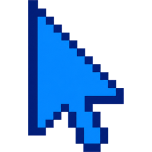
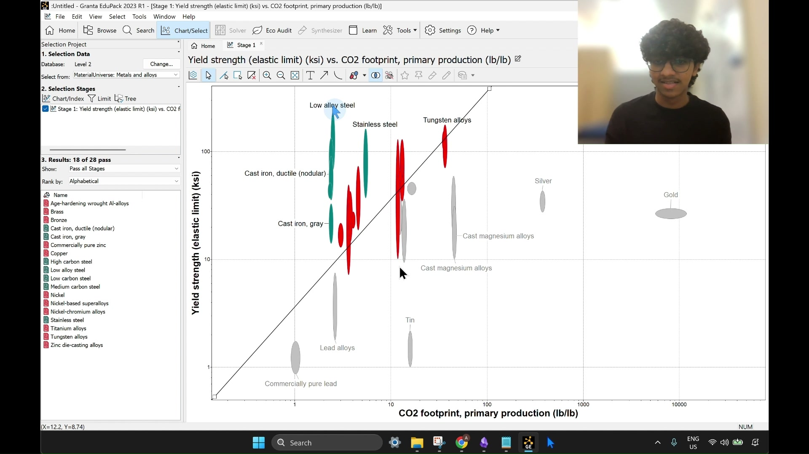
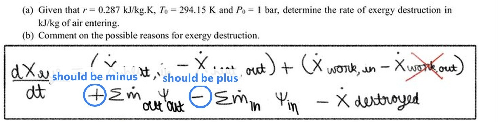
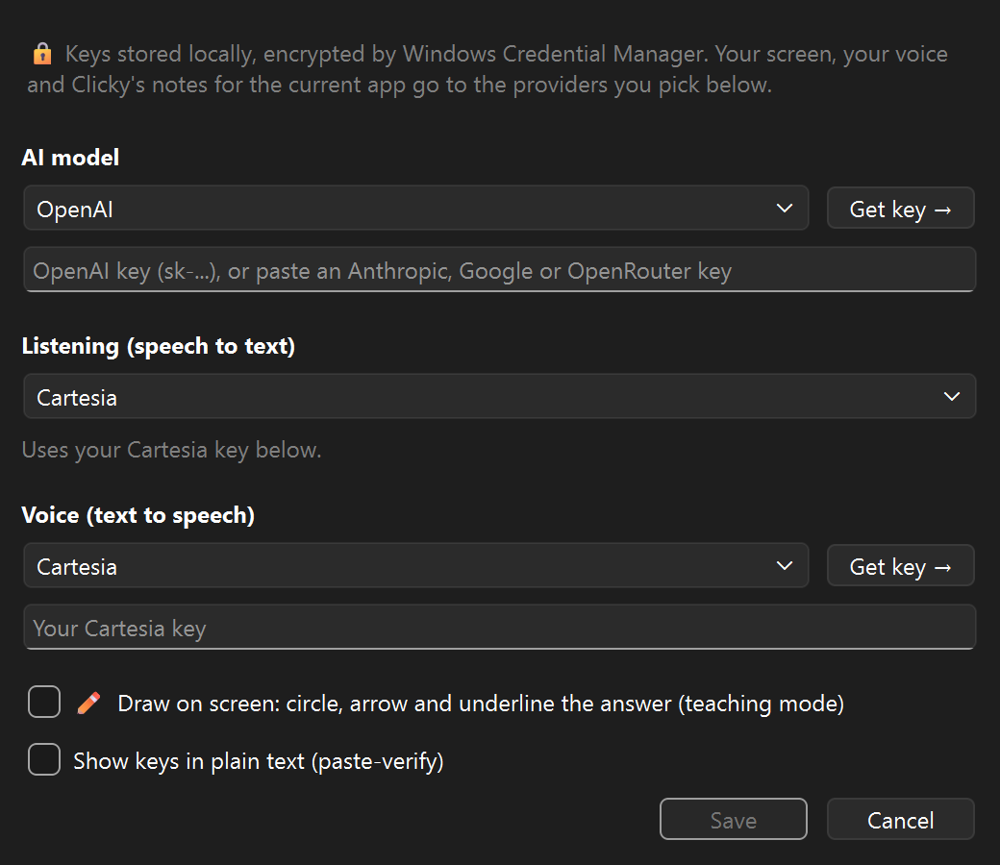
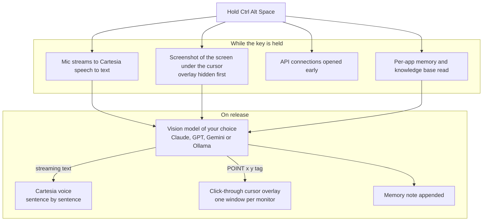
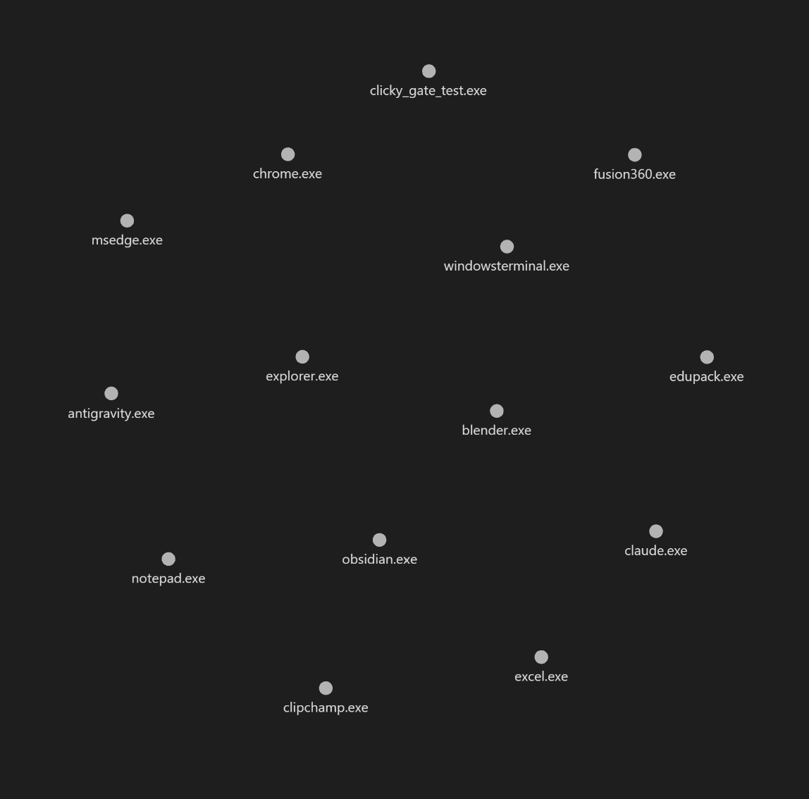

  

<h1 align="center">Clicky Windows</h1>

  An AI that lives next to your cursor on Windows. Hold a hotkey, ask about whatever app you're in, and Clicky answers out loud and points at the spot on your screen. It points, you click.

  
  

  <a href="https://github.com/AbhishekVulla/clicky-windows/releases/latest">Download</a> &middot;
  <a href="#quick-install">Install</a> &middot;
  <a href="#how-it-works">How it works</a> &middot;
  <a href="#engineering">Engineering</a> &middot;
  <a href="#faq">FAQ</a> &middot;
  <a href="#privacy">Privacy</a>

> *"I just want to learn by doing."*
> Farza Majeed, on why he built the original Clicky

The most requested feature on [Farza's Clicky](https://github.com/farzaa/clicky) was a Windows version. This is it, plus two things the original doesn't have: it remembers what you asked in each app, and each app can have its own knowledge base, so Clicky can help with software the AI has never seen.

  

  <em>90 seconds: Granta EduPack for a class project. Clicky knows the project, sees the screen, points at where to click.</em> 
  1st runner-up, <a href="https://pycon.sg/hackathon_entries/results.html">PyCon Singapore 2026 Hackathon</a>.

## What it does

You're in some app and you're stuck. Hold `Ctrl+Alt+Space`, ask out loud, let go. You hear the answer and a blue cursor lands on the button you needed. Clicky never clicks or types for you, so you come out of it knowing the app.

- **Charts.** *"What's this MACD divergence telling me?"* on TradingView, with Clicky pointing at the peaks it means.
- **Apps the AI doesn't know.** Your company's internal tools, or niche software from a class. Paste the manual into that app's knowledge base, `~/Documents/Clicky Wiki/<app>.exe.md`, and Clicky reads it before answering. I did this for Granta EduPack, a materials tool I had to use at SUTD, and now Clicky finds things in it like a TA who already read the manual.
- **A first app on Lovable, Bolt or Replit.** Ask what's broken; Clicky reads your editor and shows you where to click.

Turn on *Draw on screen* in Settings and Clicky also marks up the screen like a tutor: it circles the thing, draws an arrow, underlines a term or writes a short label.

  
   
  <em>Asked "What is the mistake in this question?" on a thermodynamics worksheet.</em>

## Quick install

**Video walkthrough:** [How to install Clicky Windows](https://youtu.be/a76r7sTNGH0) (90 seconds).

1. Download `Clicky-Windows-Setup.exe` from [Releases](https://github.com/AbhishekVulla/clicky-windows/releases/latest).
2. Run it. The installer isn't code-signed yet, so Windows SmartScreen warns you: click **More info**, then **Run anyway**.
3. Clicky asks for two keys:
   - **AI model:** an [OpenAI](https://platform.openai.com/api-keys) key. An [Anthropic](https://console.anthropic.com/settings/keys), Google or [OpenRouter](https://openrouter.ai/keys) key works too: paste it and Clicky picks that provider.
   - **Cartesia:** one [Cartesia](https://play.cartesia.ai/sign-in) key covers both listening and the voice.
4. Hold `Ctrl+Alt+Space`, ask, let go.

Cartesia has a free tier, and an answer from the AI model costs under a cent. Prefer no keys at all? Every piece has a local option; see the [FAQ](#faq).

  

## How it works

While you talk, the mic streams to speech-to-text, the screen is captured, the per-app memory and knowledge base are read, and the connections to the AI and voice providers open. When you let go, the model gets the screenshot, your words, the memory and the knowledge base, and streams its answer. Each finished sentence goes straight to the voice, so you hear the start of the answer while the rest is still being written. A `[POINT:x,y:label]` tag at the end moves the cursor.

## Engineering

<strong>Pointing that lands, measured.</strong> Every default was picked on real screenshots, and one model's misses turned out to be a coordinate bug.

Seven "where is X" questions on real screenshots (Granta EduPack, Fusion 360, GitHub), with Clicky's own prompt, October 2026. A hit means the cursor tip landed inside the target button.

| Provider | Old default | Hits | New default | Hits | Cost per question |
|---|---|---|---|---|---|
| Anthropic | Claude Sonnet 4.6 | 6/7 | Claude Haiku 5.5 | 7/7 | $0.0004 (was $0.008) |
| OpenAI | GPT-5.4 | 2/7 | GPT-6.1 Sol | 7/7 | $0.006 |
| Google | Gemini 3.1 Pro | 0/7 | Gemini 4 Argon | 7/7 | $0.006 |

Seven questions is a small sample. The point is the gap, not the decimals.

Gemini missed all seven by about 90 px, always in the same direction. That's not a weak model: Gemini grounds on a 0 to 1000 grid on each axis, even when the prompt says the image is 1280 by 800 pixels. Clicky now converts Gemini's coordinates, and its drawing tags, back to pixels. Same model, 0/7 became 6/7, and Gemini 4 Argon goes 7/7.

<strong>A faster voice.</strong> It starts 190 ms after each sentence is ready, down from 620 ms.

From letting go of the key to the first word takes 2.5 to 3.5 seconds on my laptop, and most of that is the AI model writing its first sentence. The parts Clicky controls, measured from Singapore in October 2026:

| Stage | Before | Now |
|---|---|---|
| Speech to text, release to transcript | ~420 ms (AssemblyAI, US servers) | ~160 ms (Cartesia, nearby servers) |
| Voice, sentence to first sound | ~620 ms (waited for the whole sentence) | ~190 ms (plays as audio arrives) |
| Connecting to the AI and voice providers | a fresh handshake every question | opened while you hold the key, 0.2 to 0.35 s saved |
| Hidden model "thinking" | on | off where the model allows it |

- **The voice now streams.** It used to download each sentence's whole audio before playing a sample, over a new connection per sentence. Now one connection and one audio stream stay open, and audio plays as it arrives.
- **The speech session is managed.** It opens in the background, reconnects after a dropped network, and closes after five quiet minutes.
- **Sentence streaming.** The answer is read sentence by sentence while the model is still writing the rest.

<strong>One key, any model.</strong> Switching between Claude, GPT and Gemini is a dropdown, with one OpenRouter key or each provider's own.

Each provider takes either its own key or an OpenRouter key. The key decides the route: an OpenRouter key goes through OpenRouter with the model's namespaced name (`anthropic/claude-haiku-5-5`), and a direct key goes to the provider with the bare name (`claude-haiku-5-5`). Paste one OpenRouter key once and it's reused for every provider.

Two bugs this used to hide, both fixed: a direct Anthropic key sent the OpenRouter-style model name, which Anthropic's own API doesn't accept, and a key saved in the first-launch window was ignored until a restart.

Older versions saved the default model into your settings. Clicky now tells a saved old default apart from a model you actually picked, so upgrading moves you to the new default without overriding a deliberate choice.

<strong>A click-through overlay that's right on every monitor.</strong> One window per screen, Win32 flags applied after show().

The cursor has to stay on top, let clicks pass through to the app underneath, never steal focus, and land on the right pixel when a 4K monitor at 200% sits next to a 1080p laptop at 100%. One overlay stretched across the whole desktop renders at the wrong scale on at least one screen, because Qt 6 gives each screen its own logical coordinate space. So Clicky opens one window per monitor and routes the cursor to the right one ([`overlay.py`](overlay.py)).

The click-through comes from Win32 layered-window flags set through `ctypes` (`WS_EX_LAYERED | WS_EX_TRANSPARENT | WS_EX_TOPMOST | WS_EX_NOACTIVATE | WS_EX_TOOLWINDOW`). They only stick if they're applied after `show()`, OR'd into the existing style rather than replacing it, and followed by `SetWindowPos(SWP_FRAMECHANGED)`. Miss any of the three and the overlay vanishes or eats your clicks.

<strong>A hotkey that doesn't break your typing, and only one Clicky at a time.</strong>

The hotkey listener is observe-only (`pynput.Listener(suppress=False)`): it sees the keys, and your app still gets them. Setting `suppress=True` would swallow every keystroke system-wide.

`Ctrl+Alt+Space` took three tries. `Alt+Space` clashes with the Windows window menu. `Ctrl+Shift+Space` is Excel's "select the whole sheet", and since Excel still receives the keys, it wiped your selection every time you asked a question. `Ctrl+Alt+Space` only clashes with Claude Desktop, which lets you unbind it.

Observe-only has a catch: two Clicky processes both hear the hotkey and both answer. Clicky takes a Win32 named mutex (`Local\ClickyWindows-SingleInstance-v1`) before anything else starts, so a second copy just points you to the one in the tray and exits. `CreateMutexW` needs `restype = wintypes.HANDLE`, or ctypes truncates the 64-bit handle.

<strong>Memory and a knowledge base, in plain Markdown.</strong> No vector database. You can read and edit everything Clicky knows.

- **Memory.** Every question appends a short note to `~/.clicky-windows/memory/<app>.exe.md`: what you asked, what Clicky said, where it pointed. The next question in that app gets the last 1,500 characters as context.
- **Knowledge base.** Anything in `~/Documents/Clicky Wiki/<app>.exe.md`, up to 60,000 characters, is given to the model as the reference for that app. This is how Clicky learns niche or company-internal software.

  
   
  <em>The memory folder in Obsidian: one file per app.</em>

## FAQ

<strong>Can I run it with no keys at all?</strong> Yes. Every piece has a local option.

- **Listening:** pick **Local (faster-whisper)** in Settings. Whisper on your CPU, about 150 MB downloaded once.
- **Voice:** pick **Local (Kokoro)**. About 330 MB downloaded once, then it speaks offline.
- **AI model:** pick **Ollama (local)**. Install [Ollama](https://ollama.com/download), then `ollama pull llava:7b`, the default. Any Ollama vision model can be picked in Settings.

Local is free and private, and listening and voice run on a normal CPU. The AI model is the hard part: it needs a strong GPU. On a laptop without one, a local vision model took over a minute per answer in my test and missed every target, so treat it as the private option, not the everyday one.

<strong>Which AI model should I pick?</strong>

All three hit every pointing target in the test above, so the difference is speed and reasoning. GPT-6.1 Sol is the default: with an OpenAI key it usually starts answering in about 2 seconds, and it got 5 of 6 reasoning checks right, like spotting the mistake in a worked solution. Claude Haiku 5.5 is the cheapest, about $0.0004 a question, and the fastest through an OpenRouter key, but got 3 of 6. Gemini 4 Argon got all 6 and is the slowest to start. One OpenRouter key works for all three.

## Privacy

- Your screen, your voice and Clicky's notes for the current app go straight from your PC to the providers you pick, on your own keys. With an OpenRouter key, the AI call goes through OpenRouter. Pick the local options and none of it leaves your PC.
- Keys are stored with Windows Credential Manager, encrypted for your Windows account. That protects them at rest, not from malware running as you.
- Memory and the knowledge base are plain Markdown on your disk. Read them, edit them, delete them.
- Each question also writes a short text log to `~/.clicky-windows/debug/`: what you asked, what Clicky answered and how long each step took. Screenshots aren't kept there unless you set `DEBUG_SCREENSHOTS=on`.

## Acknowledgments

Built on [Clicky by Farza Majeed](https://github.com/farzaa/clicky), the original for macOS.

## License and support

[MIT](LICENSE). A personal project, PRs welcome. Found a bug? Open an issue and attach `interaction.log` from the newest folder in `~/.clicky-windows/debug/`. It's a text log of timings, what you asked and what Clicky answered.
